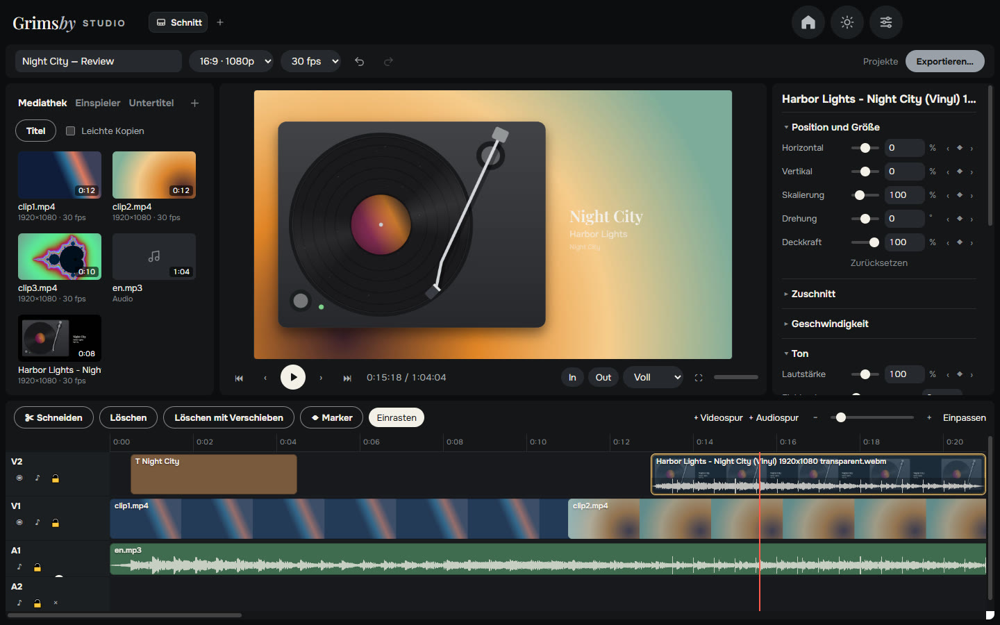
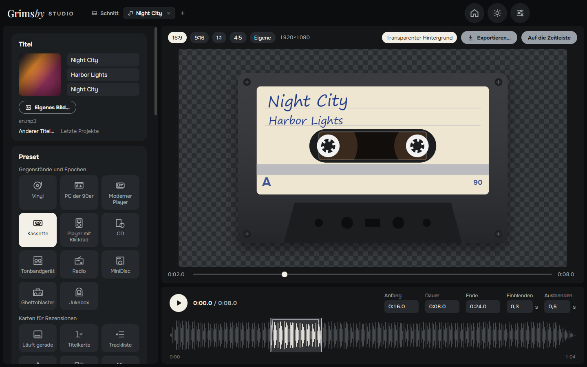
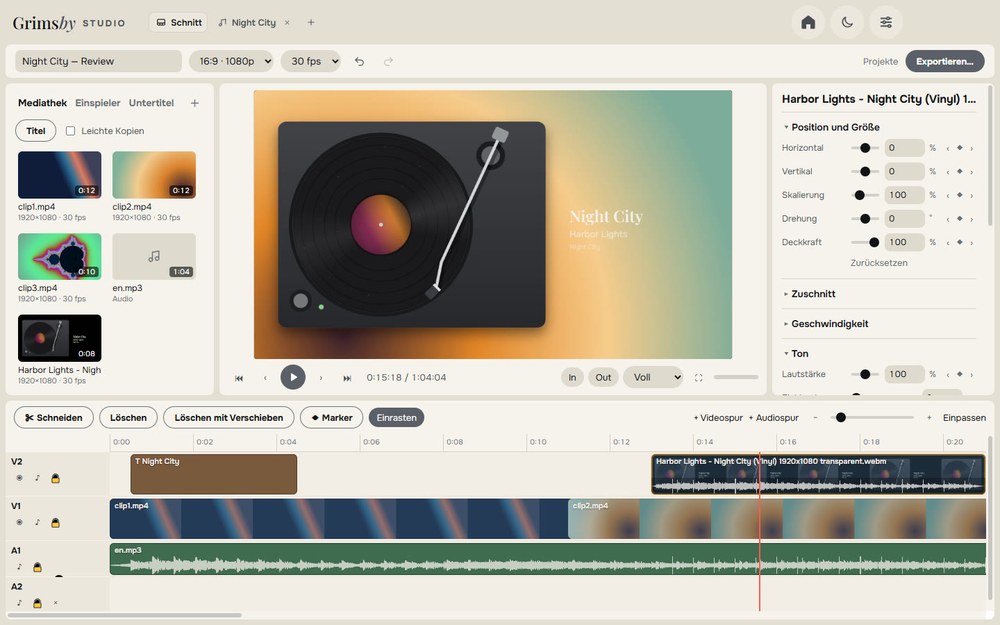

  <a href="README.md">English</a> ·
  <a href="README.ru.md">Русский</a> ·
  <a href="README.es.md">Español</a> ·
  <a href="README.pt.md">Português</a> ·
  <b>Deutsch</b> ·
  <a href="README.fr.md">Français</a> ·
  <a href="README.zh.md">中文</a> ·
  <a href="README.ja.md">日本語</a> ·
  <a href="README.ko.md">한국어</a>

  

  <b>Ein Videoeditor für Windows für Videos über Musik.</b> 
  Schneide auf einer Zeitleiste und füge animierte Einspieler aus deinen eigenen Titeln hinzu: Vinyl, Kassette, Player verschiedener Epochen, Songtexte, Karten für Kritiken und Klangvisualisierungen.

  
  
  
  
  

  <a href="https://github.com/maksimkhatskevich/grimsby-studio/releases/latest"><b>⬇ Für Windows herunterladen</b></a>
  &nbsp;·&nbsp;
  <a href="#funktionen">Funktionen</a>
  &nbsp;·&nbsp;
  <a href="#datenschutz">Datenschutz</a>
  &nbsp;·&nbsp;
  <a href="#feedback">Feedback</a>

---

## Warum Grimsby Studio

Albumkritiken, Geschichten über Musik und kurze Clips brauchen mehr als Schnitte: ein Cover auf dem Plattenspieler, eine Titelkarte, die Trackliste, den Songtext im Takt. Meist heißt das: eine eigene Animations-App oder fertige Vorlagen, die man von Hand anpasst.

**Grimsby Studio bringt beides in ein Fenster.** Schneide dein Video, wähle einen Titel und einen Stil – der Einspieler entsteht aus Cover, Interpret und Titel und landet von selbst auf der Zeitleiste, mit transparentem Hintergrund oder ohne.

---

## Funktionen

### 🎬 Schnitt für Musikvideos

Medienbibliothek, Zeitleiste mit mehreren Video- und Tonspuren, Trimmen, Tempo, Keyframes, Übergänge und Farbe. Überlagerungen mit Mischmodi, Masken, Rahmen und Einblend-Animation, Titel mit fertigen Stilen, Ton mit Normalisierung und Rauschunterdrückung für Stimmen. Einrasten, Marker, In- und Out-Punkte, Rückgängig.

### 💿 46 animierte Einspieler aus deinem Titel

Objekte und Epochen: Vinyl, Kassette, CD, Tonbandgerät, Radio, Player aus verschiedenen Jahrzehnten. Karten für Kritiken: Läuft gerade, Titelkarte, Trackliste, Bewertung, Albumfakten, Vergleich zweier Titel. Songtexte und Typografie, Klangvisualisierungen, Stimmungsszenen, Hochformat-Karten für kurze Clips. Cover, Interpret und Titel kommen aus den Tags; der Ausschnitt ist frei wählbar.

### 💬 Untertitel

Eine Untertitelspur mit eigenem Stil, Bearbeiten von Text und Zeiten, SRT-Import und -Export. Untertitel ins Bild einbrennen oder als .srt-Datei neben dem Video speichern. Automatische Untertitel aus Sprache auf Englisch, Russisch und Spanisch laufen auf deinem Computer; die Erkennungsmodelle werden nur per Knopfdruck heruntergeladen.

### 📤 Export

MP4 oder MOV, von 480p bis 4K, eigene Bitrate. Nur Ton als WAV oder MP3, Coverbild für MP4. Einspieler werden mit transparentem Hintergrund berechnet und liegen über deinem Video.

### 🪶 Flüssig auf einem normalen PC

Leichte Kopien für die Vorschau schwerer Videos, während der Export die Originale nutzt, Vorschauqualität „Halb“ und „Viertel“, für AVI und MKV entsteht automatisch eine abspielbare Kopie.

🌍 **9 Sprachen:** Englisch, Russisch, Spanisch, Portugiesisch, Deutsch, Französisch, Chinesisch, Japanisch und Koreanisch – umschalten in den Einstellungen, sofort wirksam.

Das helle Design ist einen Klick entfernt – der Sonnenknopf oben.

---

## Herunterladen und installieren

1. Öffne die Seite der **[neuesten Version](https://github.com/maksimkhatskevich/grimsby-studio/releases/latest)** und lade das Installationsprogramm `.exe` herunter.
2. Starte es. Windows zeigt eventuell ein blaues Fenster „Der Computer wurde durch Windows geschützt“ – eine normale Warnung für Programme ohne kostenpflichtiges Signaturzertifikat. Klicke auf **Weitere Informationen → Trotzdem ausführen**.
   Das Installationsprogramm wurde bei VirusTotal geprüft: [keiner der 54 Virenscanner schlägt an](https://www.virustotal.com/gui/file/26c0a09e498ed629ccdd69a3905e8b07d3879a8df6f2523b1f5a1dabf7e86209) (Version 1.0.0).
3. Klicke auf **Neues Projekt**, ziehe deine Videos und einen Titel in die Medienbibliothek und öffne den Reiter **Einspieler**.

**Voraussetzungen:** Windows 10 oder 11 (64 Bit). Internet wird nur für die Suche nach Updates gebraucht und, wenn du automatische Untertitel möchtest, für den Download eines Spracherkennungsmodells.

---

## Datenschutz

Grimsby Studio arbeitet auf deinem Computer. Deine Videos, Titel und Projekte bleiben dort und werden nie hochgeladen. Keine Konten, keine Werbung, keine Analysen. Die App geht nur online, um nach Updates zu suchen (abschaltbar) und um ein Spracherkennungsmodell herunterzuladen, wenn du auf **Herunterladen** klickst.

---

## Grimsby-Apps

<table>
  <tr>
    <td align="center" width="25%"><a href="https://github.com/maksimkhatskevich/grimsby-releases/blob/main/README.de.md"> <b>Grimsby Player</b></a> Offline-Player für deine heruntergeladene Musik und Videos</td>
    <td align="center" width="25%"><a href="https://github.com/maksimkhatskevich/grimsby-converter/blob/main/README.de.md"> <b>Grimsby Converter</b></a> Videos, Audio, Fotos und Dokumente – offline umwandeln</td>
    <td align="center" width="25%"><a href="https://github.com/maksimkhatskevich/grimsby-tagger/blob/main/README.de.md"> <b>Grimsby Tagger</b></a> Tag-Editor für ganze Alben: Tags, Cover, Dateinamen</td>
    <td align="center" width="25%"><a href="https://github.com/maksimkhatskevich/grimsby-prompter/blob/main/README.de.md"> <b>Grimsby Prompter</b></a> Ein einfacher Teleprompter, der deiner Stimme folgt</td>
  </tr>
  <tr>
    <td align="center" width="25%"><a href="https://github.com/maksimkhatskevich/grimsby-helper/blob/main/README.de.md"> <b>Grimsby Helper</b></a> PC-Zustand auf einen Blick: Prozesse, Temperaturen, Bereinigung</td>
    <td align="center" width="25%"> <b>Grimsby Studio</b> </td>
    <td align="center" width="25%"><a href="https://github.com/maksimkhatskevich/grimsby-notes/blob/main/README.de.md"> <b>Grimsby Notes</b></a> Aufgaben, Projekte, Notizen und Kalender in einem Fenster</td>
  </tr>
</table>

---

## Feedback

Einen Fehler gefunden, eine Idee oder einfach Danke sagen? Schreib mir:

- ✉️ E-Mail: **[grimsbyy@gmail.com](mailto:grimsbyy@gmail.com)**
- 🐞 Fehler und Ideen: [Issues](https://github.com/maksimkhatskevich/grimsby-studio/issues)
- 📣 Telegram: [@itsgrimsby](https://t.me/itsgrimsby) (auf Russisch)

---

## Lizenzen

Grimsby Studio nutzt Open-Source-Komponenten, darunter Electron, React, FFmpeg und music-metadata. Die vollständige Liste mit Lizenzen steht in `THIRD_PARTY.md` im Programmordner. Die Spracherkennung whisper.cpp und ihre Modelle sind nicht im Installer enthalten und werden nur auf Wunsch heruntergeladen.

© 2026 Grimsby

