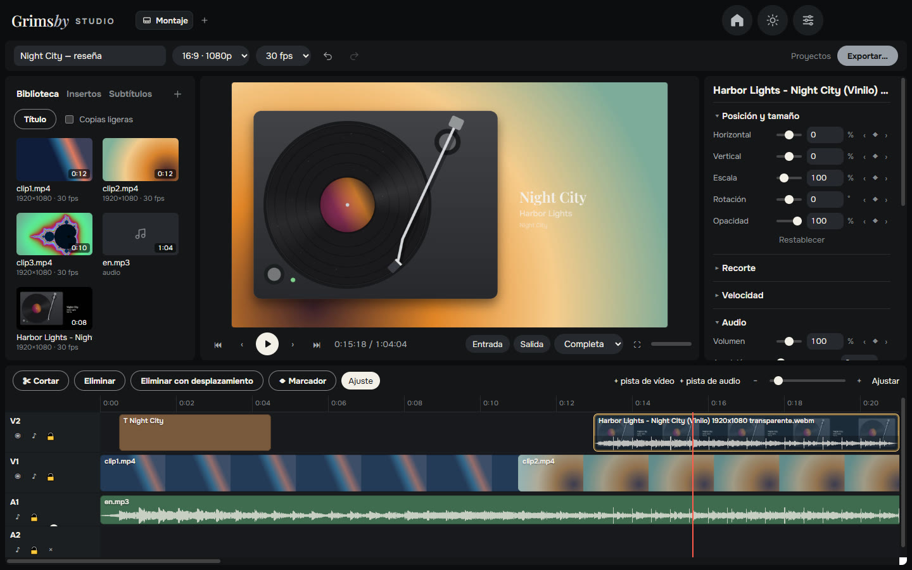
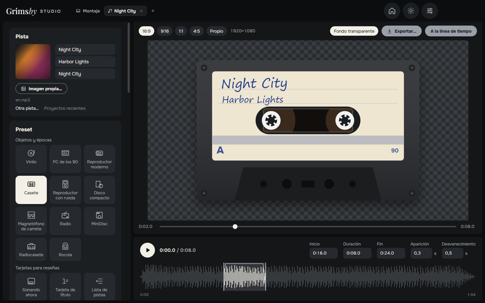
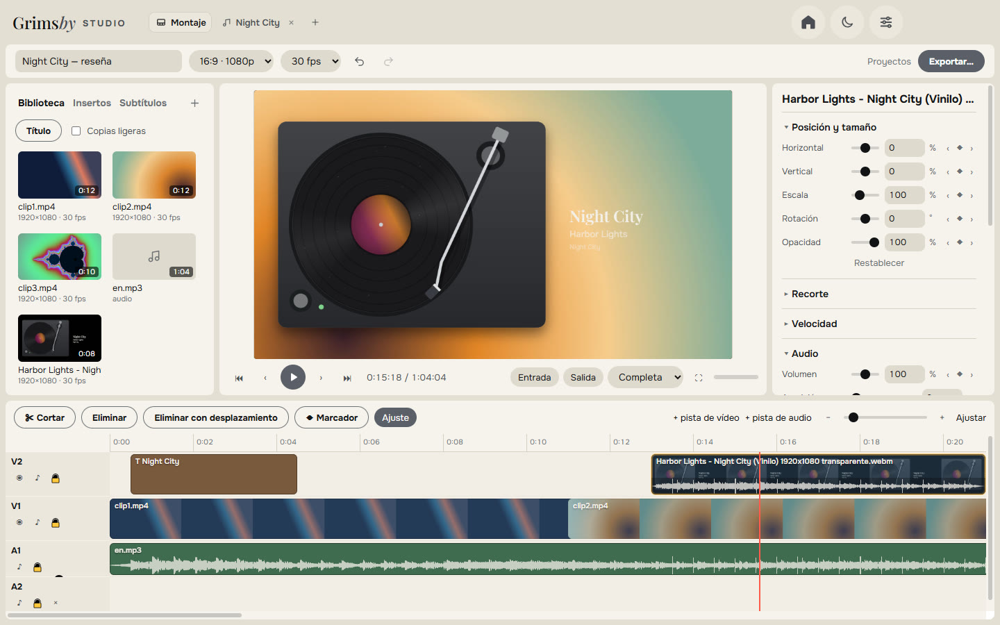

  <a href="README.md">English</a> ·
  <a href="README.ru.md">Русский</a> ·
  <b>Español</b> ·
  <a href="README.pt.md">Português</a> ·
  <a href="README.de.md">Deutsch</a> ·
  <a href="README.fr.md">Français</a> ·
  <a href="README.zh.md">中文</a> ·
  <a href="README.ja.md">日本語</a> ·
  <a href="README.ko.md">한국어</a>

  

  <b>Un editor de vídeo para Windows para vídeos sobre música.</b> 
  Monta en una línea de tiempo y añade insertos animados hechos con tus propias pistas: vinilo, casete, reproductores de distintas épocas, letras, tarjetas para reseñas y visualizadores de sonido.

  
  
  
  
  

  <a href="https://github.com/maksimkhatskevich/grimsby-studio/releases/latest"><b>⬇ Descargar para Windows</b></a>
  &nbsp;·&nbsp;
  <a href="#funciones">Funciones</a>
  &nbsp;·&nbsp;
  <a href="#privacidad">Privacidad</a>
  &nbsp;·&nbsp;
  <a href="#contacto">Contacto</a>

---

## Por qué Grimsby Studio

Las reseñas de álbumes, las historias sobre música y los vídeos cortos necesitan algo más que cortes: una portada en un tocadiscos, una tarjeta de la pista, la lista de canciones, la letra al ritmo de la música. Normalmente eso exige otra app de animación o plantillas que hay que ajustar a mano.

**Grimsby Studio lo reúne todo en una ventana.** Monta tu vídeo, elige una pista y un estilo: el inserto se crea con la portada, el artista y el título de la pista y se coloca solo en la línea de tiempo, con fondo transparente o sin él.

---

## Funciones

### 🎬 Edición para vídeos de música

Biblioteca de medios, línea de tiempo con varias pistas de vídeo y audio, recorte, velocidad, fotogramas clave, transiciones y color. Superposiciones con modos de fusión, máscaras, marcos y animación de entrada, títulos con estilos listos, sonido con normalización y reducción de ruido de voz. Ajuste a bordes, marcadores, puntos de entrada y salida, deshacer.

### 💿 46 insertos animados a partir de tu pista

Objetos y épocas: vinilo, casete, CD, magnetófono de bobinas, radio, reproductores de distintas décadas. Tarjetas para reseñas: sonando ahora, tarjeta de la pista, lista de canciones, nota, datos del álbum, comparación de dos pistas. Letras y tipografía, visualizadores de sonido, escenas de ambiente, tarjetas verticales para vídeos cortos. La portada, el artista y el título salen de las etiquetas; el fragmento de la pista, el que quieras.

### 💬 Subtítulos

Una pista de subtítulos con su propio estilo, edición del texto y los tiempos, importación y exportación SRT. Incrusta los subtítulos en la imagen o guarda un archivo .srt junto al vídeo. Los subtítulos automáticos a partir de la voz en español, inglés y ruso funcionan en tu ordenador; los modelos de reconocimiento solo se descargan al pulsar el botón.

### 📤 Exportación

MP4 o MOV, de 480p a 4K, con tu propia tasa de bits. Solo audio en WAV o MP3, portada para MP4. Los insertos se generan con fondo transparente y quedan sobre tu vídeo.

### 🪶 Fluido en un PC normal

Copias ligeras para previsualizar vídeo pesado mientras la exportación usa los originales, calidad de vista previa a la mitad y a un cuarto, y copia reproducible automática para AVI y MKV.

🌍 **9 idiomas:** inglés, ruso, español, portugués, alemán, francés, chino, japonés y coreano; se cambian en Ajustes al instante.

El tema claro está a un clic: el botón del sol, arriba.

---

## Descargar e instalar

1. Abre la página de la **[última versión](https://github.com/maksimkhatskevich/grimsby-studio/releases/latest)** y descarga el instalador `.exe`.
2. Ejecútalo. Windows puede mostrar una ventana azul «Windows protegió su PC»: es un aviso normal para programas sin certificado de firma de pago. Pulsa **Más información → Ejecutar de todas formas**.
   El instalador se ha analizado en VirusTotal: [ninguno de 54 antivirus detecta nada](https://www.virustotal.com/gui/file/26c0a09e498ed629ccdd69a3905e8b07d3879a8df6f2523b1f5a1dabf7e86209) (versión 1.0.0).
3. Pulsa **Nuevo proyecto**, arrastra tus vídeos y una pista a la biblioteca de medios y abre la pestaña **Insertos**.

**Requisitos:** Windows 10 u 11 (64 bits). Internet solo hace falta para buscar actualizaciones y, si quieres subtítulos automáticos, para descargar un modelo de reconocimiento de voz.

---

## Privacidad

Grimsby Studio funciona en tu ordenador. Tus vídeos, pistas y proyectos se guardan solo allí y nunca se suben. Sin cuentas, sin anuncios, sin analíticas. La app solo se conecta para buscar actualizaciones (se puede desactivar) y para descargar un modelo de reconocimiento de voz cuando pulsas **Descargar**.

---

## Las apps de Grimsby

<table>
  <tr>
    <td align="center" width="25%"><a href="https://github.com/maksimkhatskevich/grimsby-releases/blob/main/README.es.md"> <b>Grimsby Player</b></a> Reproductor sin conexión para tu música y videos descargados</td>
    <td align="center" width="25%"><a href="https://github.com/maksimkhatskevich/grimsby-converter/blob/main/README.es.md"> <b>Grimsby Converter</b></a> Video, audio, fotos y documentos, convertidos sin conexión</td>
    <td align="center" width="25%"><a href="https://github.com/maksimkhatskevich/grimsby-tagger/blob/main/README.es.md"> <b>Grimsby Tagger</b></a> Editor de etiquetas por lotes: álbumes, portadas, nombres de archivo</td>
    <td align="center" width="25%"><a href="https://github.com/maksimkhatskevich/grimsby-prompter/blob/main/README.es.md"> <b>Grimsby Prompter</b></a> Un teleprompter sencillo que sigue tu voz</td>
  </tr>
  <tr>
    <td align="center" width="25%"><a href="https://github.com/maksimkhatskevich/grimsby-helper/blob/main/README.es.md"> <b>Grimsby Helper</b></a> El estado de tu PC de un vistazo: procesos, temperaturas, limpieza</td>
    <td align="center" width="25%"> <b>Grimsby Studio</b> </td>
    <td align="center" width="25%"><a href="https://github.com/maksimkhatskevich/grimsby-notes/blob/main/README.es.md"> <b>Grimsby Notes</b></a> Tareas, proyectos, notas y calendario en una ventana</td>
  </tr>
</table>

---

## Contacto

¿Encontraste un error, tienes una idea o solo quieres dar las gracias? Escríbeme:

- ✉️ correo: **[grimsbyy@gmail.com](mailto:grimsbyy@gmail.com)**
- 🐞 errores e ideas: [Issues](https://github.com/maksimkhatskevich/grimsby-studio/issues)
- 📣 Telegram: [@itsgrimsby](https://t.me/itsgrimsby) (en ruso)

---

## Licencias

Grimsby Studio usa componentes de código abierto, entre ellos Electron, React, FFmpeg y music-metadata. La lista completa con las licencias está en `THIRD_PARTY.md`, en la carpeta del programa. El motor de reconocimiento de voz whisper.cpp y sus modelos no van en el instalador y solo se descargan si los pides.

© 2026 Grimsby

