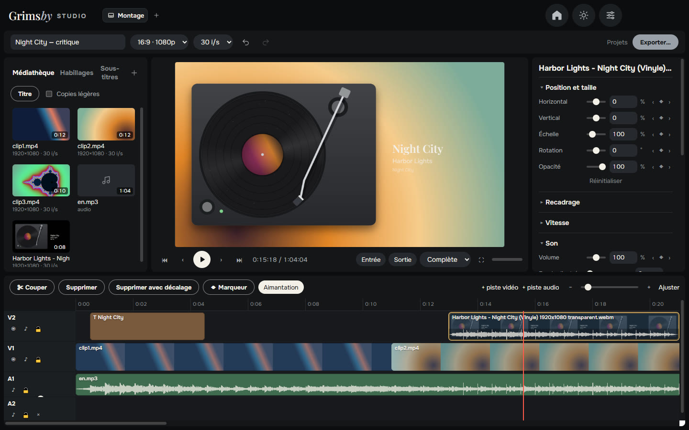
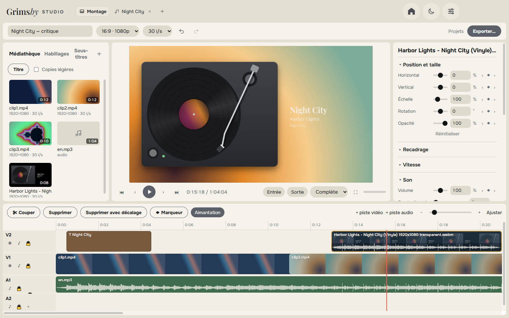

  <a href="README.md">English</a> ·
  <a href="README.ru.md">Русский</a> ·
  <a href="README.es.md">Español</a> ·
  <a href="README.pt.md">Português</a> ·
  <a href="README.de.md">Deutsch</a> ·
  <b>Français</b> ·
  <a href="README.zh.md">中文</a> ·
  <a href="README.ja.md">日本語</a> ·
  <a href="README.ko.md">한국어</a>

  

  <b>Un éditeur vidéo pour Windows pour les vidéos sur la musique.</b> 
  Montez sur une timeline et ajoutez des habillages animés créés à partir de vos propres morceaux : vinyle, cassette, lecteurs de différentes époques, paroles, cartes pour les critiques et visualiseurs sonores.

  
  
  
  
  

  <a href="https://github.com/maksimkhatskevich/grimsby-studio/releases/latest"><b>⬇ Télécharger pour Windows</b></a>
  &nbsp;·&nbsp;
  <a href="#fonctionnalités">Fonctionnalités</a>
  &nbsp;·&nbsp;
  <a href="#confidentialité">Confidentialité</a>
  &nbsp;·&nbsp;
  <a href="#contact">Contact</a>

---

## Pourquoi Grimsby Studio

Les critiques d’albums, les récits sur la musique et les clips courts demandent plus que des coupes : une pochette sur une platine, une carte du morceau, la liste des titres, les paroles en rythme. D’habitude, il faut une application d’animation à part ou des modèles à ajuster à la main.

**Grimsby Studio réunit tout dans une seule fenêtre.** Montez votre vidéo, choisissez un morceau et un style : l’habillage est créé à partir de la pochette, de l’artiste et du titre, puis se place tout seul sur la timeline, avec ou sans fond transparent.

---

## Fonctionnalités

### 🎬 Montage pour vidéos musicales

Médiathèque, timeline avec plusieurs pistes vidéo et audio, découpe, vitesse, images clés, transitions et couleur. Superpositions avec modes de fusion, masques, cadres et animation d’apparition, titres aux styles prêts à l’emploi, son avec normalisation et réduction du bruit de voix. Magnétisme, marqueurs, points d’entrée et de sortie, annulation.

### 💿 46 habillages animés à partir de votre morceau

Objets et époques : vinyle, cassette, CD, magnétophone à bandes, radio, lecteurs de différentes décennies. Cartes pour les critiques : en écoute, carte du morceau, liste des titres, note, infos sur l’album, comparaison de deux morceaux. Paroles et typographie, visualiseurs sonores, scènes d’ambiance, cartes verticales pour les vidéos courtes. Pochette, artiste et titre viennent des tags ; l’extrait du morceau est au choix.

### 💬 Sous-titres

Une piste de sous-titres avec son propre style, modification du texte et des temps, import et export SRT. Incrustez les sous-titres dans l’image ou enregistrez un fichier .srt à côté de la vidéo. Les sous-titres automatiques à partir de la voix en anglais, russe et espagnol fonctionnent sur votre ordinateur ; les modèles de reconnaissance ne sont téléchargés que sur clic.

### 📤 Export

MP4 ou MOV, de 480p à 4K, avec votre propre débit. Son seul en WAV ou MP3, image de couverture pour le MP4. Les habillages sont calculés avec un fond transparent et se posent sur votre vidéo.

### 🪶 Fluide sur un PC ordinaire

Copies légères pour prévisualiser les vidéos lourdes, l’export utilisant les originaux, qualité d’aperçu « Moitié » et « Quart », copie lisible créée automatiquement pour les AVI et MKV.

🌍 **9 langues :** anglais, russe, espagnol, portugais, allemand, français, chinois, japonais et coréen — à changer dans les Réglages, effet immédiat.

Le thème clair est à un clic — le bouton soleil en haut.

---

## Télécharger et installer

1. Ouvrez la page de la **[dernière version](https://github.com/maksimkhatskevich/grimsby-studio/releases/latest)** et téléchargez l’installeur `.exe`.
2. Lancez-le. Windows peut afficher une fenêtre bleue « Windows a protégé votre ordinateur » : c’est un avertissement normal pour les logiciels sans certificat de signature payant. Cliquez sur **Informations complémentaires → Exécuter quand même**.
   L’installeur a été vérifié sur VirusTotal : [aucun des 54 antivirus ne détecte quoi que ce soit](https://www.virustotal.com/gui/file/26c0a09e498ed629ccdd69a3905e8b07d3879a8df6f2523b1f5a1dabf7e86209) (version 1.0.0).
3. Cliquez sur **Nouveau projet**, glissez vos vidéos et un morceau dans la médiathèque et ouvrez l’onglet **Habillages**.

**Configuration requise :** Windows 10 ou 11 (64 bits). Internet n’est nécessaire que pour vérifier les mises à jour et, si vous voulez des sous-titres automatiques, télécharger un modèle de reconnaissance vocale.

---

## Confidentialité

Grimsby Studio fonctionne sur votre ordinateur. Vos vidéos, morceaux et projets restent sur votre ordinateur et ne sont jamais envoyés. Pas de compte, pas de publicité, pas de statistiques. L’application ne se connecte que pour vérifier les mises à jour (désactivable) et pour télécharger un modèle de reconnaissance vocale quand vous cliquez sur **Télécharger**.

---

## Les applis Grimsby

<table>
  <tr>
    <td align="center" width="25%"><a href="https://github.com/maksimkhatskevich/grimsby-releases/blob/main/README.fr.md"> <b>Grimsby Player</b></a> Lecteur hors ligne pour votre musique et vos clips téléchargés</td>
    <td align="center" width="25%"><a href="https://github.com/maksimkhatskevich/grimsby-converter/blob/main/README.fr.md"> <b>Grimsby Converter</b></a> Vidéo, audio, photos et documents convertis hors ligne</td>
    <td align="center" width="25%"><a href="https://github.com/maksimkhatskevich/grimsby-tagger/blob/main/README.fr.md"> <b>Grimsby Tagger</b></a> Éditeur de tags par lots : albums, pochettes, noms de fichiers</td>
    <td align="center" width="25%"><a href="https://github.com/maksimkhatskevich/grimsby-prompter/blob/main/README.fr.md"> <b>Grimsby Prompter</b></a> Un téléprompteur simple qui suit votre voix</td>
  </tr>
  <tr>
    <td align="center" width="25%"><a href="https://github.com/maksimkhatskevich/grimsby-helper/blob/main/README.fr.md"> <b>Grimsby Helper</b></a> L’état de votre PC en un coup d’œil : processus, températures, nettoyage</td>
    <td align="center" width="25%"> <b>Grimsby Studio</b> </td>
    <td align="center" width="25%"><a href="https://github.com/maksimkhatskevich/grimsby-notes/blob/main/README.fr.md"> <b>Grimsby Notes</b></a> Tâches, projets, notes et calendrier dans une seule fenêtre</td>
  </tr>
</table>

---

## Contact

Un bug, une idée ou juste envie de dire merci ? Écrivez-moi :

- ✉️ e-mail: **[grimsbyy@gmail.com](mailto:grimsbyy@gmail.com)**
- 🐞 bugs et idées: [Issues](https://github.com/maksimkhatskevich/grimsby-studio/issues)
- 📣 Telegram : [@itsgrimsby](https://t.me/itsgrimsby) (en russe)

---

## Licences

Grimsby Studio utilise des composants open source, dont Electron, React, FFmpeg et music-metadata. La liste complète avec les licences se trouve dans `THIRD_PARTY.md`, dans le dossier du programme. Le moteur de reconnaissance vocale whisper.cpp et ses modèles ne sont pas inclus dans l’installateur et ne sont téléchargés qu’à la demande.

© 2026 Grimsby

