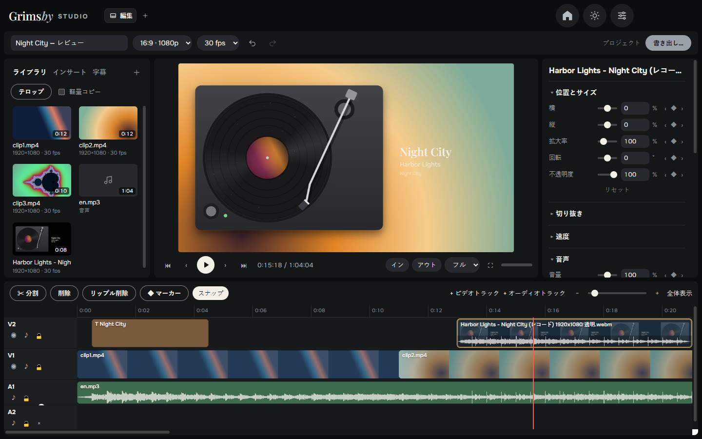
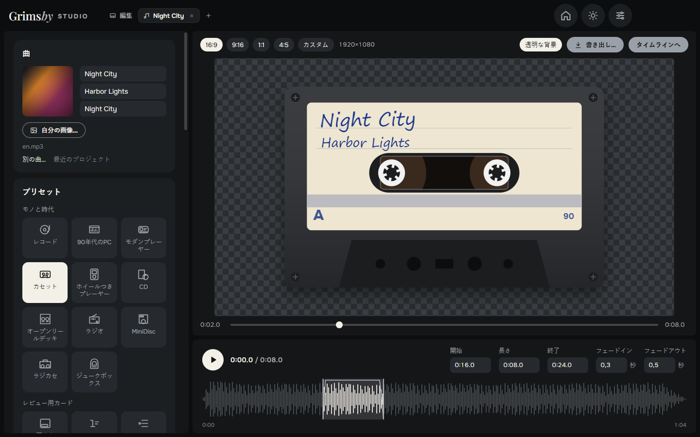
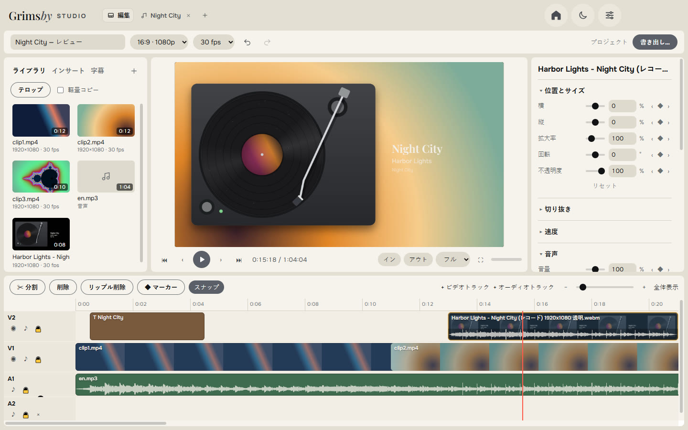

  <a href="README.md">English</a> ·
  <a href="README.ru.md">Русский</a> ·
  <a href="README.es.md">Español</a> ·
  <a href="README.pt.md">Português</a> ·
  <a href="README.de.md">Deutsch</a> ·
  <a href="README.fr.md">Français</a> ·
  <a href="README.zh.md">中文</a> ·
  <b>日本語</b> ·
  <a href="README.ko.md">한국어</a>

  

  <b>音楽を紹介する動画のための Windows 用動画エディター。</b> 
  タイムラインで編集し、自分の曲から作るアニメーションのインサートを加えられます。レコード、カセット、さまざまな時代のプレーヤー、歌詞、レビュー用カード、サウンドビジュアライザー。

  
  
  
  
  

  <a href="https://github.com/maksimkhatskevich/grimsby-studio/releases/latest"><b>⬇ Windows 版をダウンロード</b></a>
  &nbsp;·&nbsp;
  <a href="#機能">機能</a>
  &nbsp;·&nbsp;
  <a href="#プライバシー">プライバシー</a>
  &nbsp;·&nbsp;
  <a href="#お問い合わせ">お問い合わせ</a>

---

## Grimsby Studio を選ぶ理由

アルバムレビューや音楽の話、短い動画には、カットだけでは足りません。プレーヤーに載ったジャケット、曲のカード、曲目リスト、音楽に合わせた歌詞。ふつうは別のアニメーションソフトか、手で直すテンプレートが必要です。

**Grimsby Studio はそれをひとつのウィンドウにまとめます。** 動画を編集し、曲とスタイルを選ぶだけ。インサートは曲のジャケット、アーティスト、曲名から作られ、透明背景でもそのままでもタイムラインに置かれます。

---

## 機能

### 🎬 音楽動画のための編集

ライブラリ、複数の映像・音声トラックを持つタイムライン、トリミング、速度、キーフレーム、トランジション、色調整。描画モード、マスク、フレーム、登場アニメーション付きのオーバーレイ、スタイル付きのタイトル、ノーマライズと声のノイズ除去。スナップ、マーカー、イン点とアウト点、元に戻す。

### 💿 自分の曲から作る 46 種類のアニメーションインサート

モノと時代：レコード、カセット、CD、オープンリール、ラジオ、さまざまな年代のプレーヤー。レビュー用カード：再生中、曲カード、曲目リスト、評価、アルバム情報、2 曲の比較。歌詞とタイポグラフィ、サウンドビジュアライザー、雰囲気のあるシーン、ショート動画向けの縦型カード。ジャケット、アーティスト、曲名はタグから、曲の区間は自由に選べます。

### 💬 字幕

独自のスタイルを持つ字幕トラック、テキストとタイミングの編集、SRT の読み込みと書き出し。字幕を映像に焼き込むか、動画の横に .srt ファイルとして保存。英語・ロシア語・スペイン語の音声からの自動字幕はパソコン上で動作し、認識モデルはボタンを押したときだけダウンロードされます。

### 📤 書き出し

MP4 または MOV、480p から 4K、ビットレートも指定可能。音声のみを WAV または MP3 で、MP4 にはカバー画像も。インサートは透明背景で書き出され、動画の上に重ねられます。

### 🪶 ふつうの PC でもなめらか

重い動画は軽量コピーでプレビューし、書き出しには元のファイルを使用。プレビュー画質「1/2」「1/4」、AVI と MKV には再生用のコピーを自動作成。

🌍 **9 言語：** 英語、ロシア語、スペイン語、ポルトガル語、ドイツ語、フランス語、中国語、日本語、韓国語。設定で切り替えるとすぐに反映されます。

ライトテーマもワンクリック。上の太陽ボタンです。

---

## ダウンロードとインストール

1. **[最新バージョン](https://github.com/maksimkhatskevich/grimsby-studio/releases/latest)** のページを開き、インストーラー `.exe` をダウンロードします。
2. 実行します。Windows に青い「Windows によって PC が保護されました」画面が出ることがありますが、有料の署名証明書がないアプリでは普通の警告です。**詳細情報 → 実行** をクリックしてください。
   インストーラーは VirusTotal で確認済みです：[54 のウイルス対策エンジンすべてで検出なし](https://www.virustotal.com/gui/file/26c0a09e498ed629ccdd69a3905e8b07d3879a8df6f2523b1f5a1dabf7e86209)（バージョン 1.0.0）。
3. **新しいプロジェクト** をクリックし、動画と曲をライブラリにドロップして **インサート** タブを開きます。

**動作環境：** Windows 10 / 11（64 ビット）。

---

## プライバシー

Grimsby Studio はパソコンの中で動作します。動画、曲、プロジェクトはそこだけに保存され、アップロードされることはありません。アカウントなし、広告なし、解析なし。インターネットに接続するのは、アップデートの確認（オフ可）と、**ダウンロード** を押したときの音声認識モデルの取得だけです。

---

## Grimsby のアプリ

<table>
  <tr>
    <td align="center" width="25%"><a href="https://github.com/maksimkhatskevich/grimsby-releases/blob/main/README.ja.md"> <b>Grimsby Player</b></a> ダウンロードした音楽と MV のためのオフラインプレーヤー</td>
    <td align="center" width="25%"><a href="https://github.com/maksimkhatskevich/grimsby-converter/blob/main/README.ja.md"> <b>Grimsby Converter</b></a> 動画・音声・写真・文書をオフラインで変換</td>
    <td align="center" width="25%"><a href="https://github.com/maksimkhatskevich/grimsby-tagger/blob/main/README.ja.md"> <b>Grimsby Tagger</b></a> タグ一括編集：アルバム、カバー、ファイル名</td>
    <td align="center" width="25%"><a href="https://github.com/maksimkhatskevich/grimsby-prompter/blob/main/README.ja.md"> <b>Grimsby Prompter</b></a> 声についてくる、シンプルなプロンプター</td>
  </tr>
  <tr>
    <td align="center" width="25%"><a href="https://github.com/maksimkhatskevich/grimsby-helper/blob/main/README.ja.md"> <b>Grimsby Helper</b></a> PC の状態がひと目でわかる：プロセス、温度、クリーンアップ</td>
    <td align="center" width="25%"> <b>Grimsby Studio</b> </td>
    <td align="center" width="25%"><a href="https://github.com/maksimkhatskevich/grimsby-notes/blob/main/README.ja.md"> <b>Grimsby Notes</b></a> タスク、プロジェクト、ノート、カレンダーをひとつのウィンドウで</td>
  </tr>
</table>

---

## お問い合わせ

不具合を見つけた、アイデアがある、またはお礼を伝えたい？ご連絡ください：

- ✉️ メール: **[grimsbyy@gmail.com](mailto:grimsbyy@gmail.com)**
- 🐞 不具合とアイデア: [Issues](https://github.com/maksimkhatskevich/grimsby-studio/issues)
- 📣 Telegram：[@itsgrimsby](https://t.me/itsgrimsby)（ロシア語）

---

## ライセンス

Grimsby Studio は Electron、React、FFmpeg、music-metadata などのオープンソースコンポーネントを使用しています。ライセンス付きの完全な一覧はプログラムフォルダーの `THIRD_PARTY.md` にあります。音声認識エンジン whisper.cpp とそのモデルはインストーラーに含まれず、必要なときだけダウンロードされます。

© 2026 Grimsby

