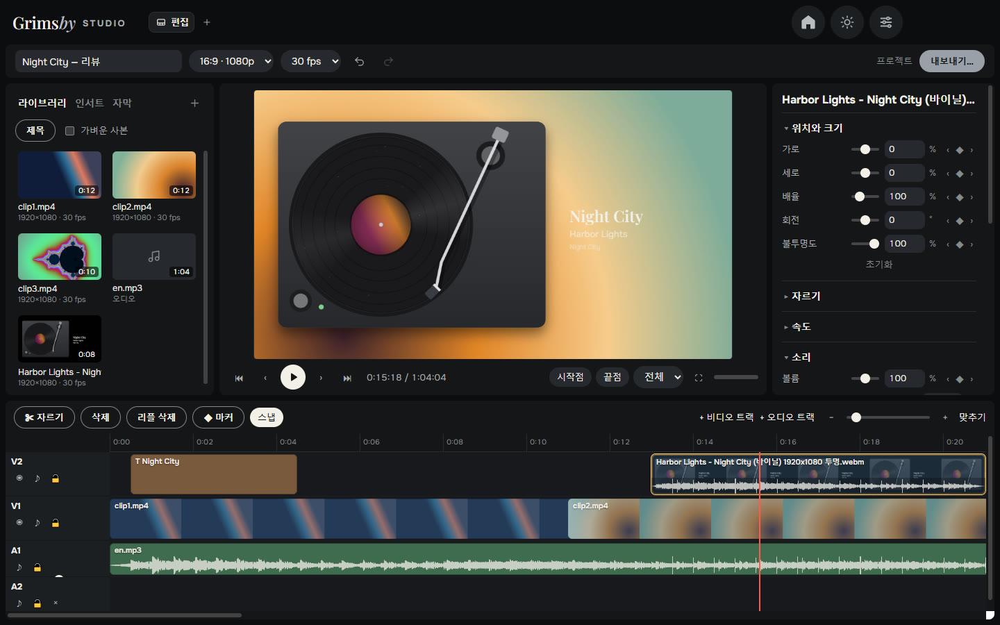
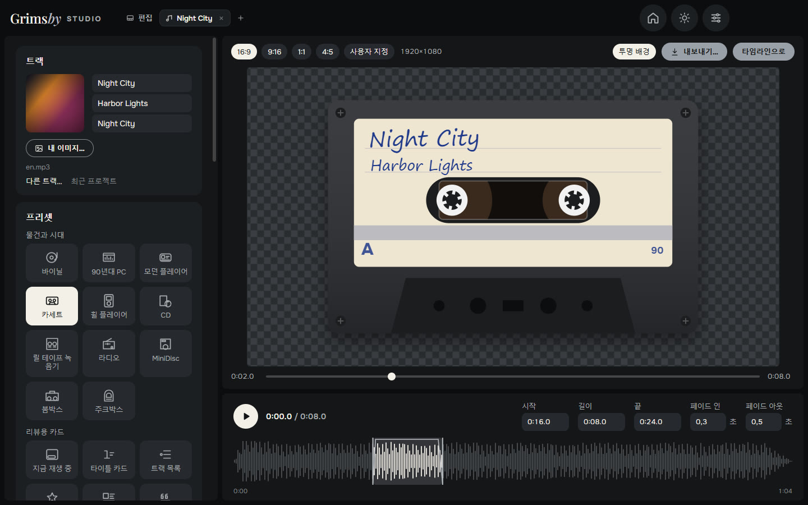
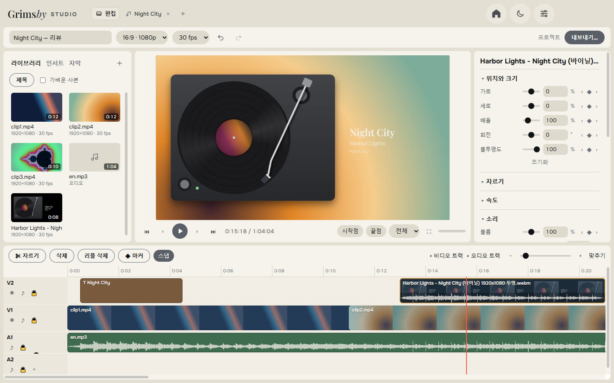

  <a href="README.md">English</a> ·
  <a href="README.ru.md">Русский</a> ·
  <a href="README.es.md">Español</a> ·
  <a href="README.pt.md">Português</a> ·
  <a href="README.de.md">Deutsch</a> ·
  <a href="README.fr.md">Français</a> ·
  <a href="README.zh.md">中文</a> ·
  <a href="README.ja.md">日本語</a> ·
  <b>한국어</b>

  

  <b>음악을 다루는 영상을 위한 Windows 동영상 편집기.</b> 
  타임라인에서 편집하고, 내 곡으로 만든 애니메이션 인서트를 넣으세요. 바이닐, 카세트, 여러 시대의 플레이어, 가사, 리뷰용 카드, 사운드 시각화까지.

  
  
  
  
  

  <a href="https://github.com/maksimkhatskevich/grimsby-studio/releases/latest"><b>⬇ Windows용 다운로드</b></a>
  &nbsp;·&nbsp;
  <a href="#기능">기능</a>
  &nbsp;·&nbsp;
  <a href="#개인정보">개인정보</a>
  &nbsp;·&nbsp;
  <a href="#문의">문의</a>

---

## 왜 Grimsby Studio인가

앨범 리뷰, 음악 이야기, 짧은 영상에는 컷 편집만으로는 부족합니다. 턴테이블 위의 커버, 곡 카드, 트랙리스트, 음악에 맞춘 가사가 필요하죠. 보통은 별도의 애니메이션 앱이나 손으로 고쳐야 하는 템플릿이 필요합니다.

**Grimsby Studio는 이 모든 것을 한 창에 담았습니다.** 영상을 편집하고 곡과 스타일을 고르세요. 인서트는 곡의 커버, 아티스트, 제목으로 만들어져 투명 배경이든 아니든 타임라인에 바로 놓입니다.

---

## 기능

### 🎬 음악 영상을 위한 편집

미디어 라이브러리, 여러 영상·오디오 트랙이 있는 타임라인, 자르기, 속도, 키프레임, 전환 효과, 색 보정. 혼합 모드, 마스크, 프레임, 등장 애니메이션이 있는 오버레이, 준비된 스타일의 자막 타이틀, 노멀라이즈와 음성 노이즈 제거. 스냅, 마커, 시작점과 끝점, 실행 취소.

### 💿 내 곡으로 만드는 46가지 애니메이션 인서트

사물과 시대: 바이닐, 카세트, CD, 릴 테이프, 라디오, 여러 시대의 플레이어. 리뷰용 카드: 지금 재생 중, 곡 카드, 트랙리스트, 평점, 앨범 정보, 두 곡 비교. 가사와 타이포그래피, 사운드 시각화, 분위기 있는 장면, 짧은 영상용 세로 카드. 커버, 아티스트, 제목은 태그에서 가져오고 곡 구간은 마음대로 고를 수 있습니다.

### 💬 자막

고유한 스타일의 자막 트랙, 텍스트와 타이밍 편집, SRT 가져오기와 내보내기. 자막을 화면에 새기거나 영상 옆에 .srt 파일로 저장하세요. 영어, 러시아어, 스페인어 음성으로 만드는 자동 자막은 내 컴퓨터에서 실행되며, 인식 모델은 버튼을 누를 때만 다운로드됩니다.

### 📤 내보내기

MP4 또는 MOV, 480p부터 4K까지, 비트레이트 지정 가능. 오디오만 WAV 또는 MP3로, MP4에는 커버 이미지. 인서트는 투명 배경으로 만들어져 영상 위에 겹쳐집니다.

### 🪶 평범한 PC에서도 부드럽게

무거운 영상은 가벼운 사본으로 미리 보고 내보내기는 원본으로, 미리 보기 화질 ‘절반’과 ‘1/4’, AVI와 MKV는 재생용 사본을 자동으로 만듭니다.

🌍 **9개 언어:** 영어, 러시아어, 스페인어, 포르투갈어, 독일어, 프랑스어, 중국어, 일본어, 한국어 — 설정에서 바꾸면 바로 적용됩니다.

라이트 테마도 클릭 한 번, 위쪽의 해 모양 버튼입니다.

---

## 다운로드 및 설치

1. **[최신 버전](https://github.com/maksimkhatskevich/grimsby-studio/releases/latest)** 페이지를 열고 설치 프로그램 `.exe`를 다운로드하세요.
2. 실행하세요. Windows가 파란색 "Windows의 PC 보호" 창을 띄울 수 있는데, 유료 코드 서명 인증서가 없는 프로그램에 대한 일반적인 경고입니다. **추가 정보 → 실행**을 누르세요.
   설치 프로그램은 VirusTotal에서 검사했습니다: [백신 엔진 54개 모두 이상 없음](https://www.virustotal.com/gui/file/26c0a09e498ed629ccdd69a3905e8b07d3879a8df6f2523b1f5a1dabf7e86209) (버전 1.0.0).
3. **새 프로젝트**를 누르고 영상과 곡을 미디어 라이브러리에 끌어다 놓은 다음 **인서트** 탭을 여세요.

**요구 사항:** Windows 10 또는 11(64비트). 인터넷은 업데이트 확인과, 자동 자막을 쓸 때 음성 인식 모델을 다운로드할 때만 필요합니다.

---

## 개인정보

Grimsby Studio는 내 컴퓨터에서 동작합니다. 영상, 곡, 프로젝트는 그곳에만 저장되며 업로드되지 않습니다. 계정, 광고, 분석 없음. 인터넷에는 업데이트 확인(끌 수 있음)과 **다운로드**를 누를 때 음성 인식 모델을 받을 때만 연결합니다.

---

## Grimsby 앱

<table>
  <tr>
    <td align="center" width="25%"><a href="https://github.com/maksimkhatskevich/grimsby-releases/blob/main/README.ko.md"> <b>Grimsby Player</b></a> 다운로드한 음악과 뮤직비디오를 위한 오프라인 플레이어</td>
    <td align="center" width="25%"><a href="https://github.com/maksimkhatskevich/grimsby-converter/blob/main/README.ko.md"> <b>Grimsby Converter</b></a> 영상, 오디오, 사진, 문서를 오프라인으로 변환</td>
    <td align="center" width="25%"><a href="https://github.com/maksimkhatskevich/grimsby-tagger/blob/main/README.ko.md"> <b>Grimsby Tagger</b></a> 태그 일괄 편집: 앨범, 커버, 파일 이름</td>
    <td align="center" width="25%"><a href="https://github.com/maksimkhatskevich/grimsby-prompter/blob/main/README.ko.md"> <b>Grimsby Prompter</b></a> 목소리를 따라가는 간단한 프롬프터</td>
  </tr>
  <tr>
    <td align="center" width="25%"><a href="https://github.com/maksimkhatskevich/grimsby-helper/blob/main/README.ko.md"> <b>Grimsby Helper</b></a> PC 상태를 한눈에: 프로세스, 온도, 정리</td>
    <td align="center" width="25%"> <b>Grimsby Studio</b> </td>
    <td align="center" width="25%"><a href="https://github.com/maksimkhatskevich/grimsby-notes/blob/main/README.ko.md"> <b>Grimsby Notes</b></a> 할 일, 프로젝트, 노트, 캘린더를 한 창에서</td>
  </tr>
</table>

---

## 문의

버그를 찾았거나, 아이디어가 있거나, 그냥 고맙다고 말하고 싶다면 연락 주세요:

- ✉️ 이메일: **[grimsbyy@gmail.com](mailto:grimsbyy@gmail.com)**
- 🐞 버그와 아이디어: [Issues](https://github.com/maksimkhatskevich/grimsby-studio/issues)
- 📣 Telegram: [@itsgrimsby](https://t.me/itsgrimsby) (러시아어)

---

## 라이선스

Grimsby Studio는 Electron, React, FFmpeg, music-metadata 등 오픈 소스 구성 요소를 사용합니다. 라이선스가 포함된 전체 목록은 프로그램 폴더의 `THIRD_PARTY.md`에 있습니다. 음성 인식 엔진 whisper.cpp와 모델은 설치 프로그램에 포함되지 않으며 요청할 때만 다운로드됩니다.

© 2026 Grimsby

