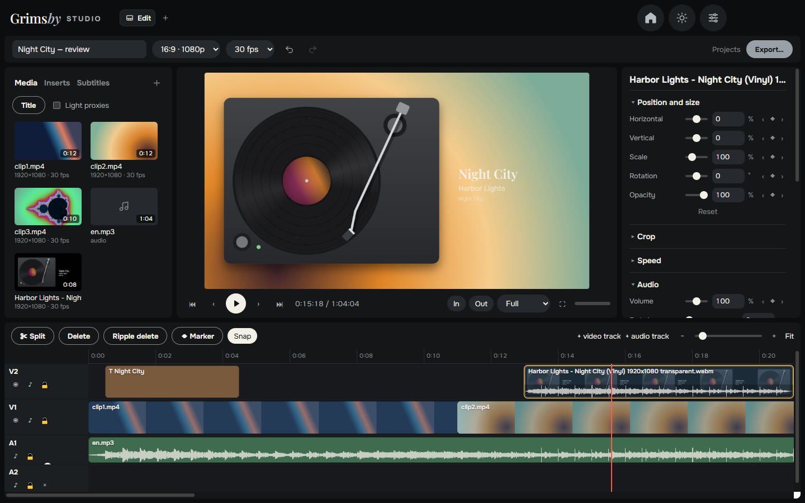
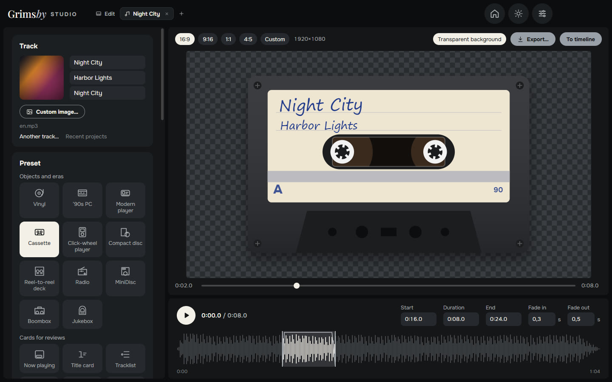
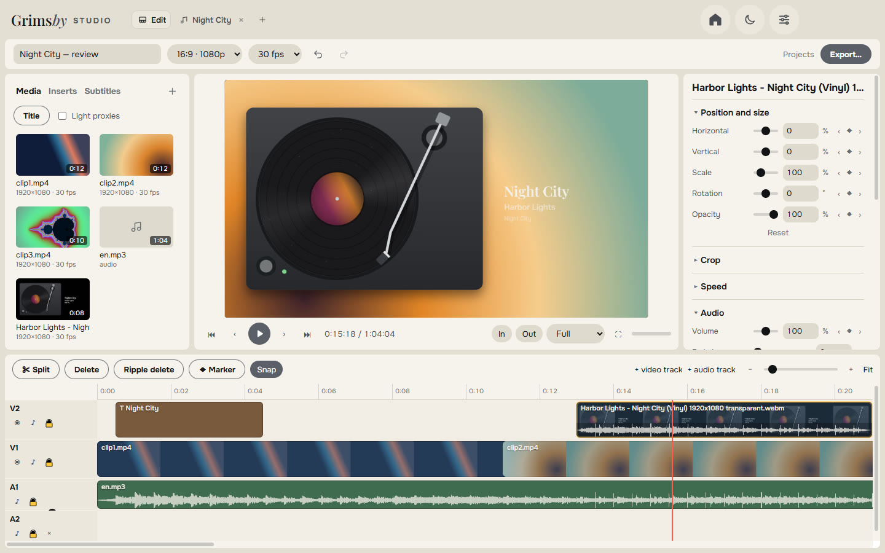

  <b>English</b> ·
  <a href="README.ru.md">Русский</a> ·
  <a href="README.es.md">Español</a> ·
  <a href="README.pt.md">Português</a> ·
  <a href="README.de.md">Deutsch</a> ·
  <a href="README.fr.md">Français</a> ·
  <a href="README.zh.md">中文</a> ·
  <a href="README.ja.md">日本語</a> ·
  <a href="README.ko.md">한국어</a>

  

  <b>A video editor for Windows for videos about music.</b> 
  Edit on a timeline and add animated inserts made from your own tracks: vinyl, cassette, players of different eras, lyrics, cards for reviews and sound visualizers.

  
  
  
  
  

  <a href="https://github.com/maksimkhatskevich/grimsby-studio/releases/latest"><b>⬇ Download for Windows</b></a>
  &nbsp;·&nbsp;
  <a href="#features">Features</a>
  &nbsp;·&nbsp;
  <a href="#privacy">Privacy</a>
  &nbsp;·&nbsp;
  <a href="#feedback">Feedback</a>

---

## Why Grimsby Studio

Album reviews, music stories and short clips need more than cuts: a cover on a record player, a title card, a tracklist, lyrics in time with the music. Usually that means a separate motion design app or ready-made templates you have to adjust by hand.

**Grimsby Studio puts both in one window.** Edit your footage, pick a track and a style — the insert is built from the track’s cover, artist and title and lands on the timeline, with a transparent background or without.

---

## Features

### 🎬 Editing for music videos

Media library, timeline with several video and audio tracks, trimming, speed, keyframes, transitions and color. Overlays with blend modes, masks, frames and appearance animation, titles with ready-made styles, sound with normalization and voice noise reduction. Snapping, markers, in and out points, undo.

### 💿 46 animated inserts from your track

Objects and eras: vinyl, cassette, CD, reel-to-reel, radio, players of different decades. Cards for reviews: now playing, title card, tracklist, rating, album facts, comparison of two tracks. Lyrics and typography, sound visualizers, atmospheric scenes, vertical cards for short videos. Cover, artist and title are taken from the tags; pick any segment of the track.

### 💬 Subtitles

A subtitle track with its own style, editing of text and timing, SRT import and export. Burn subtitles into the picture or save an .srt file next to the video. Automatic subtitles from speech in English, Russian and Spanish run on your computer; the recognition models are downloaded only when you click the button.

### 📤 Export

MP4 or MOV, from 480p to 4K, your own bitrate. Audio only as WAV or MP3, a cover image for MP4. Inserts are rendered with a transparent background, so they sit on top of your video.

### 🪶 Smooth on an ordinary PC

Light copies for previewing heavy footage while export uses the originals, half and quarter preview quality, files in AVI and MKV get a playable copy automatically.

🌍 **9 languages:** English, Russian, Spanish, Portuguese, German, French, Chinese, Japanese and Korean — switch in Settings, it changes right away.

The light theme is one click away — the sun button at the top.

---

## Download and install

1. Open the **[latest release](https://github.com/maksimkhatskevich/grimsby-studio/releases/latest)** page and download the installer `.exe`.
2. Run it. Windows may show a blue "Windows protected your PC" window — that's a normal warning for apps without a paid code-signing certificate. Click **More info → Run anyway**.
   The installer has been checked on VirusTotal: [0 of 54 antivirus engines flag it](https://www.virustotal.com/gui/file/26c0a09e498ed629ccdd69a3905e8b07d3879a8df6f2523b1f5a1dabf7e86209) (version 1.0.0).
3. Click **New project**, drop your videos and a track into the media library and open the **Inserts** tab.

**Requirements:** Windows 10 or 11 (64-bit). Internet is needed only to check for updates and, if you want automatic subtitles, to download a speech recognition model.

---

## Privacy

Grimsby Studio works on your computer. Your videos, tracks and projects are stored only there and are never uploaded. No accounts, no ads, no analytics. The app goes online only to check for updates (this can be turned off) and to download a speech recognition model when you click **Download**.

---

## Grimsby apps

<table>
  <tr>
    <td align="center" width="25%"><a href="https://github.com/maksimkhatskevich/grimsby-releases"> <b>Grimsby Player</b></a> Offline music & video player for your downloaded collection</td>
    <td align="center" width="25%"><a href="https://github.com/maksimkhatskevich/grimsby-converter"> <b>Grimsby Converter</b></a> Video, audio, photos and documents — converted offline</td>
    <td align="center" width="25%"><a href="https://github.com/maksimkhatskevich/grimsby-tagger"> <b>Grimsby Tagger</b></a> Batch tag editor: albums, covers, file names</td>
    <td align="center" width="25%"><a href="https://github.com/maksimkhatskevich/grimsby-prompter"> <b>Grimsby Prompter</b></a> A simple teleprompter that follows your voice</td>
  </tr>
  <tr>
    <td align="center" width="25%"><a href="https://github.com/maksimkhatskevich/grimsby-helper"> <b>Grimsby Helper</b></a> PC health at a glance: processes, temperatures, cleanup</td>
    <td align="center" width="25%"> <b>Grimsby Studio</b> </td>
    <td align="center" width="25%"><a href="https://github.com/maksimkhatskevich/grimsby-notes"> <b>Grimsby Notes</b></a> Tasks, projects, notes and calendar in one window</td>
  </tr>
</table>

---

## Feedback

Found a bug, have an idea or just want to say thanks? Get in touch:

- ✉️ email: **[grimsbyy@gmail.com](mailto:grimsbyy@gmail.com)**
- 🐞 bugs and ideas: [Issues](https://github.com/maksimkhatskevich/grimsby-studio/issues)
- 📣 Telegram: [@itsgrimsby](https://t.me/itsgrimsby) (in Russian)

---

## Licenses

Grimsby Studio uses open-source components, including Electron, React, FFmpeg and music-metadata. The full list with licenses is in `THIRD_PARTY.md` in the program folder. The speech recognition engine whisper.cpp and its models are not included in the installer and are downloaded only on request.

© 2026 Grimsby

