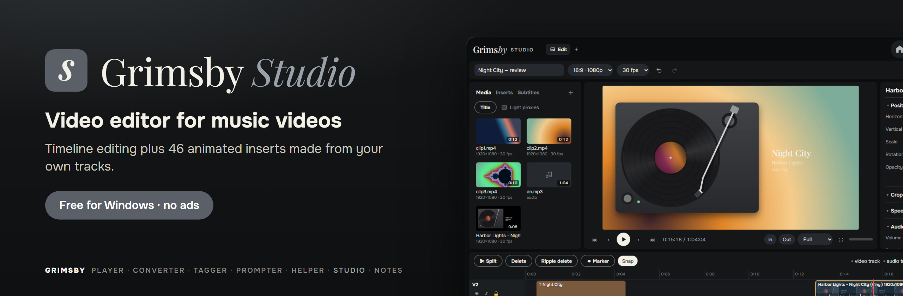
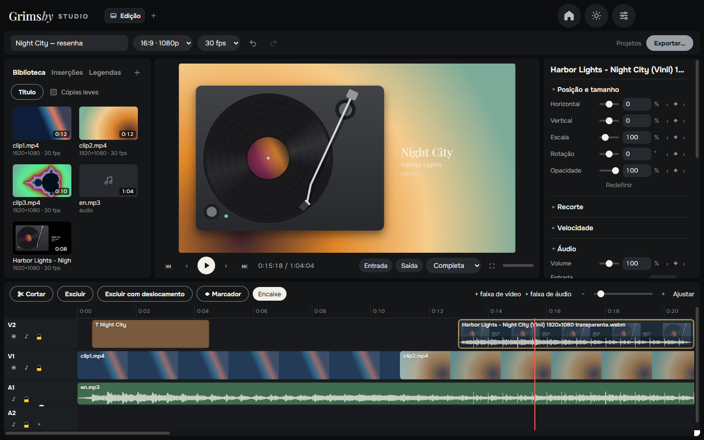
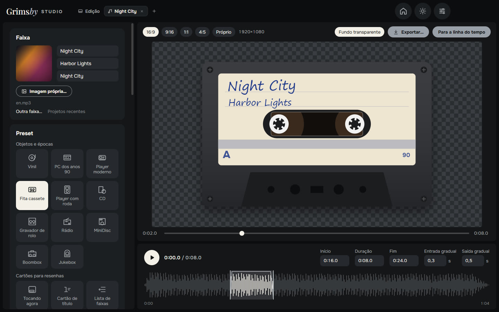
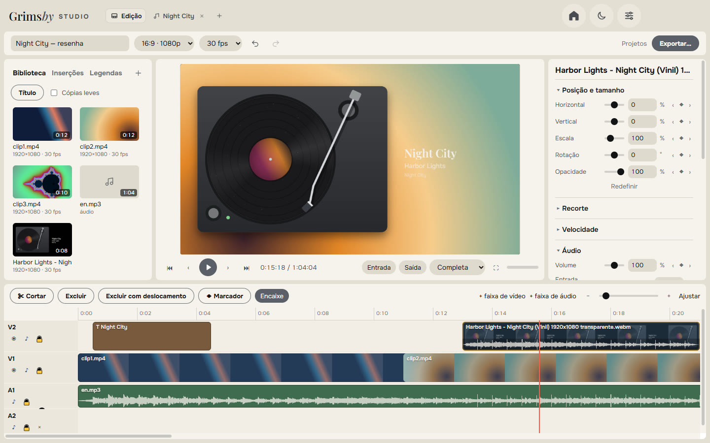

  <a href="README.md">English</a> ·
  <a href="README.ru.md">Русский</a> ·
  <a href="README.es.md">Español</a> ·
  <b>Português</b> ·
  <a href="README.de.md">Deutsch</a> ·
  <a href="README.fr.md">Français</a> ·
  <a href="README.zh.md">中文</a> ·
  <a href="README.ja.md">日本語</a> ·
  <a href="README.ko.md">한국어</a>

  

  <b>Um editor de vídeo para Windows para vídeos sobre música.</b> 
  Monte numa linha do tempo e adicione inserções animadas feitas com suas próprias faixas: vinil, fita cassete, players de várias épocas, letras, cartões para resenhas e visualizadores de som.

  
  
  
  
  

  <a href="https://github.com/maksimkhatskevich/grimsby-studio/releases/latest"><b>⬇ Baixar para Windows</b></a>
  &nbsp;·&nbsp;
  <a href="#recursos">Recursos</a>
  &nbsp;·&nbsp;
  <a href="#privacidade">Privacidade</a>
  &nbsp;·&nbsp;
  <a href="#contato">Contato</a>

---

## Por que o Grimsby Studio

Resenhas de álbuns, histórias sobre música e vídeos curtos precisam de mais do que cortes: uma capa num toca-discos, um cartão da faixa, a lista de faixas, a letra no ritmo da música. Normalmente isso exige outro app de animação ou modelos prontos que você ajusta à mão.

**O Grimsby Studio reúne tudo numa janela.** Monte seu vídeo, escolha uma faixa e um estilo: a inserção é criada com a capa, o artista e o título da faixa e vai sozinha para a linha do tempo, com fundo transparente ou sem.

---

## Recursos

### 🎬 Edição para vídeos de música

Biblioteca de mídia, linha do tempo com várias trilhas de vídeo e áudio, corte, velocidade, quadros-chave, transições e cor. Sobreposições com modos de mesclagem, máscaras, molduras e animação de entrada, títulos com estilos prontos, som com normalização e redução de ruído de voz. Encaixe nas bordas, marcadores, pontos de entrada e saída, desfazer.

### 💿 46 inserções animadas a partir da sua faixa

Objetos e épocas: vinil, fita, CD, gravador de rolo, rádio, players de várias décadas. Cartões para resenhas: tocando agora, cartão da faixa, lista de faixas, nota, dados do álbum, comparação de duas faixas. Letras e tipografia, visualizadores de som, cenas de clima, cartões verticais para vídeos curtos. Capa, artista e título vêm das tags; o trecho da faixa, você escolhe.

### 💬 Legendas

Uma trilha de legendas com estilo próprio, edição de texto e tempos, importação e exportação SRT. Grave as legendas na imagem ou salve um arquivo .srt ao lado do vídeo. As legendas automáticas a partir da fala em inglês, russo e espanhol funcionam no seu computador; os modelos de reconhecimento só são baixados quando você clica no botão.

### 📤 Exportação

MP4 ou MOV, de 480p a 4K, com taxa de bits própria. Só áudio em WAV ou MP3, capa para MP4. As inserções são geradas com fundo transparente e ficam por cima do seu vídeo.

### 🪶 Fluido num PC comum

Cópias leves para pré-visualizar vídeos pesados enquanto a exportação usa os originais, qualidade de pré-visualização de metade e um quarto, e cópia reproduzível automática para AVI e MKV.

🌍 **9 idiomas:** inglês, russo, espanhol, português, alemão, francês, chinês, japonês e coreano — troque nas Configurações, muda na hora.

O tema claro fica a um clique — o botão do sol, no alto.

---

## Baixar e instalar

1. Abra a página da **[versão mais recente](https://github.com/maksimkhatskevich/grimsby-studio/releases/latest)** e baixe o instalador `.exe`.
2. Execute-o. O Windows pode mostrar uma janela azul «O Windows protegeu o computador» — é um aviso normal para programas sem certificado de assinatura pago. Clique em **Mais informações → Executar assim mesmo**.
   O instalador foi verificado no VirusTotal: [nenhum dos 54 antivírus encontrou nada](https://www.virustotal.com/gui/file/26c0a09e498ed629ccdd69a3905e8b07d3879a8df6f2523b1f5a1dabf7e86209) (versão 1.0.0).
3. Clique em **Novo projeto**, arraste seus vídeos e uma faixa para a biblioteca de mídia e abra a aba **Inserções**.

**Requisitos:** Windows 10 ou 11 (64 bits). A internet só é necessária para verificar atualizações e, se quiser legendas automáticas, baixar um modelo de reconhecimento de fala.

---

## Privacidade

O Grimsby Studio funciona no seu computador. Seus vídeos, faixas e projetos ficam só nele e nunca são enviados. Sem contas, sem anúncios, sem análises. O app só se conecta para verificar atualizações (dá para desativar) e para baixar um modelo de reconhecimento de fala quando você clica em **Baixar**.

---

## Os apps Grimsby

<table>
  <tr>
    <td align="center" width="25%"><a href="https://github.com/maksimkhatskevich/grimsby-releases/blob/main/README.pt.md"> <b>Grimsby Player</b></a> Player offline para suas músicas e clipes baixados</td>
    <td align="center" width="25%"><a href="https://github.com/maksimkhatskevich/grimsby-converter/blob/main/README.pt.md"> <b>Grimsby Converter</b></a> Vídeo, áudio, fotos e documentos convertidos offline</td>
    <td align="center" width="25%"><a href="https://github.com/maksimkhatskevich/grimsby-tagger/blob/main/README.pt.md"> <b>Grimsby Tagger</b></a> Editor de tags em lote: álbuns, capas, nomes de arquivos</td>
    <td align="center" width="25%"><a href="https://github.com/maksimkhatskevich/grimsby-prompter/blob/main/README.pt.md"> <b>Grimsby Prompter</b></a> Um teleprompter simples que acompanha sua voz</td>
  </tr>
  <tr>
    <td align="center" width="25%"><a href="https://github.com/maksimkhatskevich/grimsby-helper/blob/main/README.pt.md"> <b>Grimsby Helper</b></a> A saúde do PC de relance: processos, temperaturas, limpeza</td>
    <td align="center" width="25%"> <b>Grimsby Studio</b> </td>
    <td align="center" width="25%"><a href="https://github.com/maksimkhatskevich/grimsby-notes/blob/main/README.pt.md"> <b>Grimsby Notes</b></a> Tarefas, projetos, notas e calendário em uma janela</td>
  </tr>
</table>

---

## Contato

Encontrou um erro, tem uma ideia ou só quer agradecer? Escreva:

- ✉️ e-mail: **[grimsbyy@gmail.com](mailto:grimsbyy@gmail.com)**
- 🐞 erros e ideias: [Issues](https://github.com/maksimkhatskevich/grimsby-studio/issues)
- 📣 Telegram: [@itsgrimsby](https://t.me/itsgrimsby) (em russo)

---

## Licenças

O Grimsby Studio usa componentes de código aberto, incluindo Electron, React, FFmpeg e music-metadata. A lista completa com as licenças está em `THIRD_PARTY.md`, na pasta do programa. O mecanismo de reconhecimento de fala whisper.cpp e seus modelos não vêm no instalador e só são baixados a pedido.

© 2026 Grimsby

