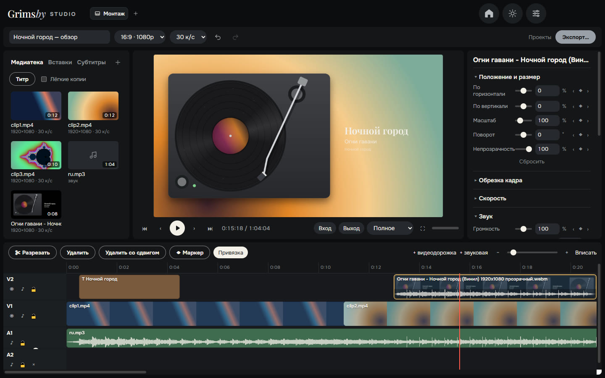
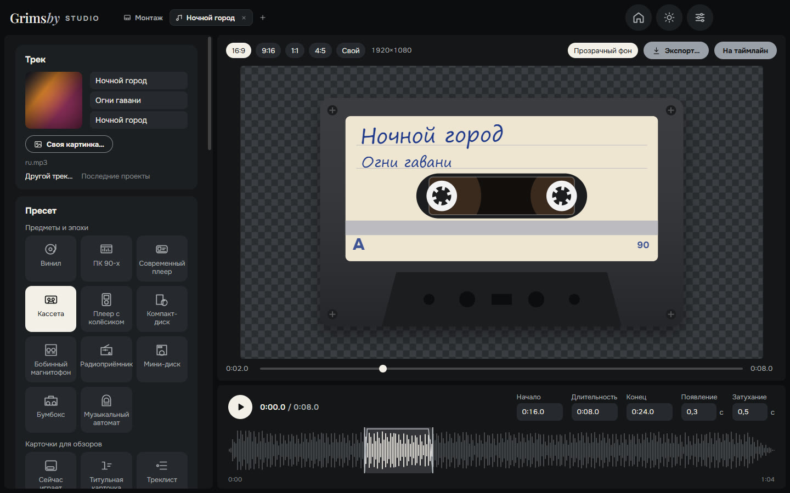
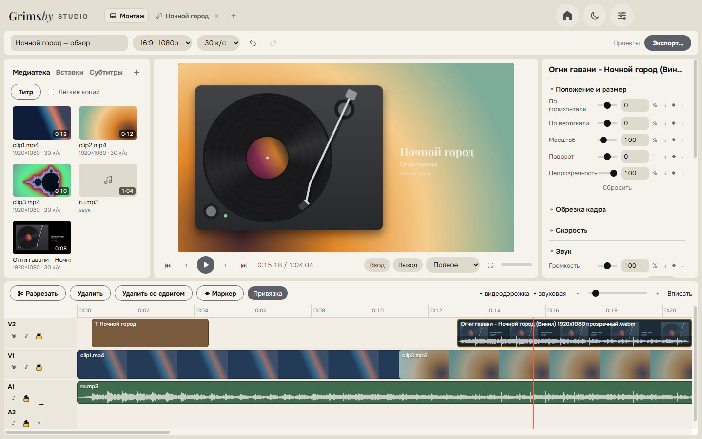

  <a href="README.md">English</a> ·
  <b>Русский</b> ·
  <a href="README.es.md">Español</a> ·
  <a href="README.pt.md">Português</a> ·
  <a href="README.de.md">Deutsch</a> ·
  <a href="README.fr.md">Français</a> ·
  <a href="README.zh.md">中文</a> ·
  <a href="README.ja.md">日本語</a> ·
  <a href="README.ko.md">한국어</a>

  

  <b>Видеоредактор для Windows для роликов о музыке.</b> 
  Монтируйте на таймлайне и добавляйте анимированные вставки из своих треков: винил, кассета, плееры разных эпох, текст песни, карточки для обзоров и визуализаторы звука.

  
  
  
  
  

  <a href="https://github.com/maksimkhatskevich/grimsby-studio/releases/latest"><b>⬇ Скачать для Windows</b></a>
  &nbsp;·&nbsp;
  <a href="#возможности">Возможности</a>
  &nbsp;·&nbsp;
  <a href="#приватность">Приватность</a>
  &nbsp;·&nbsp;
  <a href="#обратная-связь">Обратная связь</a>

---

## Зачем Grimsby Studio

Обзорам альбомов, рассказам о музыке и коротким роликам мало просто склеек: нужна обложка на проигрывателе, карточка трека, треклист, текст в такт музыке. Обычно для этого нужна отдельная программа для анимации или готовые шаблоны, которые приходится подгонять вручную.

**Grimsby Studio собирает всё в одном окне.** Смонтируйте видео, выберите трек и стиль — вставка соберётся из обложки, исполнителя и названия трека и сама ляжет на таймлайн, с прозрачным фоном или без.

---

## Возможности

### 🎬 Монтаж для роликов о музыке

Медиатека, таймлайн с несколькими видео- и звуковыми дорожками, обрезка, скорость, ключевые кадры, переходы и цвет. Наложение с режимами смешивания, масками, рамками и анимацией появления, титры с готовыми стилями, звук с нормализацией и шумоподавлением голоса. Привязка к краям, маркеры, вход и выход, отмена действий.

### 💿 46 анимированных вставок из вашего трека

Предметы и эпохи: винил, кассета, компакт-диск, бобинник, радио, плееры разных десятилетий. Карточки для обзоров: «сейчас играет», карточка трека, треклист, оценка, справка об альбоме, сравнение двух треков. Текст песни и типографика, визуализаторы звука, атмосферные сцены, вертикальные карточки для коротких роликов. Обложка, исполнитель и название берутся из тегов, отрезок трека — любой.

### 💬 Субтитры

Дорожка субтитров со своим стилем, правка текста и времени, импорт и экспорт SRT. Вшить субтитры в картинку или сохранить файл .srt рядом с видео. Автосубтитры по речи на русском, английском и испанском работают на вашем компьютере; модели распознавания скачиваются только по кнопке.

### 📤 Экспорт

MP4 или MOV, от 480p до 4K, свой битрейт. Только звук — WAV или MP3, обложка у MP4. Вставки собираются с прозрачным фоном и ложатся поверх вашего видео.

### 🪶 Плавно на обычном ПК

Лёгкие копии для просмотра тяжёлого видео — экспорт при этом идёт по оригиналам, качество просмотра «Половина» и «Четверть», для AVI и MKV копия для просмотра готовится сама.

🌍 **9 языков:** русский, английский, испанский, португальский, немецкий, французский, китайский, японский и корейский — переключаются в настройках сразу.

Светлая тема — в один клик, кнопка с солнцем вверху.

---

## Скачать и установить

1. Откройте страницу **[последней версии](https://github.com/maksimkhatskevich/grimsby-studio/releases/latest)** и скачайте установщик `.exe`.
2. Запустите его. Windows может показать синее окно «Система Windows защитила ваш компьютер» — это обычное предупреждение для программ без платного сертификата подписи. Нажмите **Подробнее → Выполнить в любом случае**.
   Установщик проверен на VirusTotal: [ни один из 54 антивирусов ничего не нашёл](https://www.virustotal.com/gui/file/26c0a09e498ed629ccdd69a3905e8b07d3879a8df6f2523b1f5a1dabf7e86209) (версия 1.0.0).
3. Нажмите **«Новый проект»**, перетащите видео и трек в медиатеку и откройте вкладку **«Вставки»**.

**Требования:** Windows 10 или 11 (64 бит). Интернет нужен только чтобы проверить обновления и, если нужны автосубтитры, скачать модель распознавания речи.

---

## Приватность

Grimsby Studio работает на вашем компьютере. Видео, треки и проекты хранятся только на нём и никуда не загружаются. Без аккаунтов, рекламы и аналитики. В интернет программа выходит, только чтобы проверить обновления (можно выключить) и скачать модель распознавания речи, когда вы нажмёте **«Скачать»**.

---

## Программы Grimsby

<table>
  <tr>
    <td align="center" width="25%"><a href="https://github.com/maksimkhatskevich/grimsby-releases/blob/main/README.ru.md"> <b>Grimsby Player</b></a> Офлайн-плеер для скачанной музыки и клипов</td>
    <td align="center" width="25%"><a href="https://github.com/maksimkhatskevich/grimsby-converter/blob/main/README.ru.md"> <b>Grimsby Converter</b></a> Видео, аудио, фото и документы — конвертация без интернета</td>
    <td align="center" width="25%"><a href="https://github.com/maksimkhatskevich/grimsby-tagger/blob/main/README.ru.md"> <b>Grimsby Tagger</b></a> Пакетный редактор тегов: альбомы, обложки, имена файлов</td>
    <td align="center" width="25%"><a href="https://github.com/maksimkhatskevich/grimsby-prompter/blob/main/README.ru.md"> <b>Grimsby Prompter</b></a> Простой телесуфлёр, который следует за голосом</td>
  </tr>
  <tr>
    <td align="center" width="25%"><a href="https://github.com/maksimkhatskevich/grimsby-helper/blob/main/README.ru.md"> <b>Grimsby Helper</b></a> Состояние ПК с первого взгляда: процессы, температуры, чистка</td>
    <td align="center" width="25%"> <b>Grimsby Studio</b> </td>
    <td align="center" width="25%"><a href="https://github.com/maksimkhatskevich/grimsby-notes/blob/main/README.ru.md"> <b>Grimsby Notes</b></a> Задачи, проекты, заметки и календарь в одном окне</td>
  </tr>
</table>

---

## Обратная связь

Нашли ошибку, есть идея или просто хотите сказать спасибо? Пишите:

- ✉️ почта: **[grimsbyy@gmail.com](mailto:grimsbyy@gmail.com)**
- 🐞 ошибки и идеи: [Issues](https://github.com/maksimkhatskevich/grimsby-studio/issues)
- 📣 Telegram: [@itsgrimsby](https://t.me/itsgrimsby)

---

## Лицензии

Grimsby Studio использует компоненты с открытым кодом, в том числе Electron, React, FFmpeg и music-metadata. Полный список с лицензиями — в файле `THIRD_PARTY.md` в папке программы. Движок распознавания речи whisper.cpp и его модели не входят в установщик и скачиваются только по запросу.

© 2026 Grimsby

