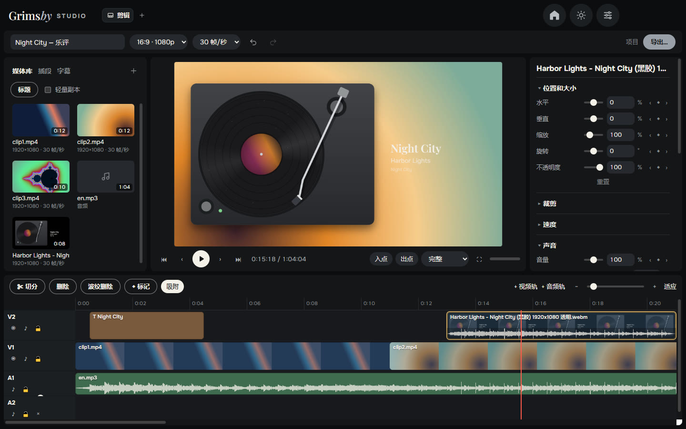
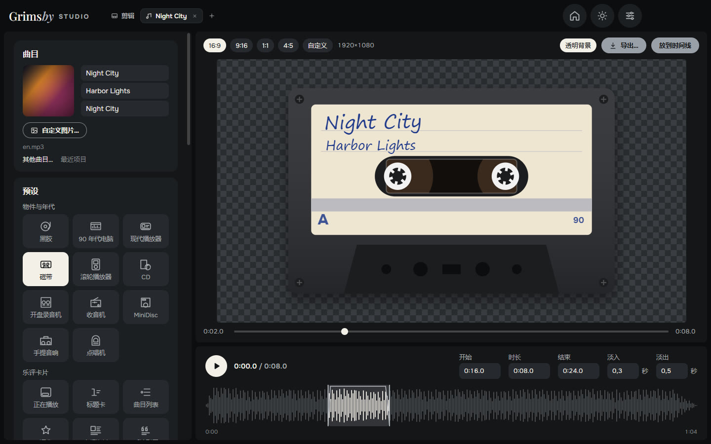
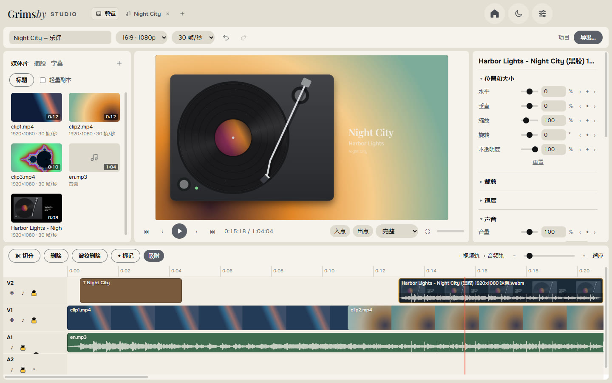

  <a href="README.md">English</a> ·
  <a href="README.ru.md">Русский</a> ·
  <a href="README.es.md">Español</a> ·
  <a href="README.pt.md">Português</a> ·
  <a href="README.de.md">Deutsch</a> ·
  <a href="README.fr.md">Français</a> ·
  <b>中文</b> ·
  <a href="README.ja.md">日本語</a> ·
  <a href="README.ko.md">한국어</a>

  

  <b>为音乐类视频打造的 Windows 视频编辑器。</b> 
  在时间线上剪辑，并用你自己的曲目生成动画插段：黑胶、磁带、各个年代的播放器、歌词、乐评卡片和声音可视化。

  
  
  
  
  

  <a href="https://github.com/maksimkhatskevich/grimsby-studio/releases/latest"><b>⬇ 下载 Windows 版</b></a>
  &nbsp;·&nbsp;
  <a href="#功能">功能</a>
  &nbsp;·&nbsp;
  <a href="#隐私">隐私</a>
  &nbsp;·&nbsp;
  <a href="#反馈">反馈</a>

---

## 为什么选择 Grimsby Studio

专辑乐评、音乐故事和短视频需要的不只是剪辑：唱机上的封面、曲目卡片、曲目表、随音乐出现的歌词。通常这意味着另开一个动画软件，或者手动调整现成的模板。

**Grimsby Studio 把这些放进一个窗口。** 剪好视频，选一首曲目和一种风格——插段会用曲目的封面、艺人和标题生成，并自动放到时间线上，可带透明背景。

---

## 功能

### 🎬 为音乐视频而做的剪辑

媒体库，多条视频和音频轨道的时间线，裁剪、变速、关键帧、转场和调色。叠加支持混合模式、蒙版、边框和出现动画，字幕带现成样式，声音可标准化并降低人声噪音。吸附、标记、入点和出点、撤销。

### 💿 由你的曲目生成 46 种动画插段

物件与年代：黑胶、磁带、CD、开盘机、收音机、不同年代的播放器。乐评卡片：正在播放、曲目卡、曲目表、评分、专辑资料、两首曲目对比。歌词与文字排版、声音可视化、氛围场景、适合短视频的竖版卡片。封面、艺人和标题取自标签，曲目片段任意选择。

### 💬 字幕

独立样式的字幕轨，编辑文字和时间，导入和导出 SRT。可把字幕烧录进画面，或在视频旁保存 .srt 文件。英语、俄语和西班牙语的语音自动字幕在你的电脑上运行；识别模型只有在点击按钮后才会下载。

### 📤 导出

MP4 或 MOV，480p 到 4K，可自定码率。仅导出音频为 WAV 或 MP3，可为 MP4 设置封面。插段以透明背景渲染，可叠在你的视频上。

### 🪶 普通电脑也流畅

轻量副本用于预览大体积视频，导出时仍使用原始文件；预览画质可选“一半”和“四分之一”；AVI 和 MKV 会自动生成可播放的副本。

🌍 **9 种语言：** 英语、俄语、西班牙语、葡萄牙语、德语、法语、中文、日语和韩语——在设置中切换，立即生效。

浅色主题一键切换——顶部的太阳按钮。

---

## 下载与安装

1. 打开 **[最新版本](https://github.com/maksimkhatskevich/grimsby-studio/releases/latest)** 页面，下载安装程序 `.exe`。
2. 运行它。Windows 可能会显示蓝色的“Windows 已保护你的电脑”窗口——这是没有付费代码签名证书的程序的正常提示。点击 **更多信息 → 仍要运行**。
   安装程序已在 VirusTotal 上检测：[54 款杀毒引擎均未发现问题](https://www.virustotal.com/gui/file/26c0a09e498ed629ccdd69a3905e8b07d3879a8df6f2523b1f5a1dabf7e86209)（1.0.0 版）。
3. 点击 **新建项目**，把视频和一首曲目拖进媒体库，然后打开 **插段** 标签页。

**系统要求：** Windows 10 或 11（64 位）。

---

## 隐私

Grimsby Studio 在你的电脑上运行。你的视频、曲目和项目只保存在本机，绝不会上传。没有账号、没有广告、没有统计。软件只在检查更新（可关闭）以及你点击 **下载** 获取语音识别模型时联网。

---

## Grimsby 应用

<table>
  <tr>
    <td align="center" width="25%"><a href="https://github.com/maksimkhatskevich/grimsby-releases/blob/main/README.zh.md"> <b>Grimsby Player</b></a> 为你下载的音乐和 MV 打造的离线播放器</td>
    <td align="center" width="25%"><a href="https://github.com/maksimkhatskevich/grimsby-converter/blob/main/README.zh.md"> <b>Grimsby Converter</b></a> 视频、音频、照片和文档，离线转换</td>
    <td align="center" width="25%"><a href="https://github.com/maksimkhatskevich/grimsby-tagger/blob/main/README.zh.md"> <b>Grimsby Tagger</b></a> 批量标签编辑：专辑、封面、文件名</td>
    <td align="center" width="25%"><a href="https://github.com/maksimkhatskevich/grimsby-prompter/blob/main/README.zh.md"> <b>Grimsby Prompter</b></a> 会跟随你声音的简单提词器</td>
  </tr>
  <tr>
    <td align="center" width="25%"><a href="https://github.com/maksimkhatskevich/grimsby-helper/blob/main/README.zh.md"> <b>Grimsby Helper</b></a> 电脑状态一目了然：进程、温度、清理</td>
    <td align="center" width="25%"> <b>Grimsby Studio</b> </td>
    <td align="center" width="25%"><a href="https://github.com/maksimkhatskevich/grimsby-notes/blob/main/README.zh.md"> <b>Grimsby Notes</b></a> 任务、项目、笔记和日历，一个窗口全搞定</td>
  </tr>
</table>

---

## 反馈

发现了问题、有想法，或者只是想说声谢谢？欢迎联系：

- ✉️ 邮箱: **[grimsbyy@gmail.com](mailto:grimsbyy@gmail.com)**
- 🐞 问题与建议: [Issues](https://github.com/maksimkhatskevich/grimsby-studio/issues)
- 📣 Telegram：[@itsgrimsby](https://t.me/itsgrimsby)（俄语）

---

## 许可证

Grimsby Studio 使用了开源组件，包括 Electron、React、FFmpeg 和 music-metadata。完整列表及许可证见程序文件夹中的 `THIRD_PARTY.md`。语音识别引擎 whisper.cpp 及其模型不包含在安装程序中，仅在你需要时下载。

© 2026 Grimsby

